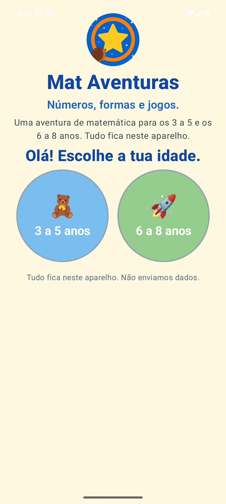

# Mat Aventuras

[](https://www.bestpractices.dev/projects/16162)

Offline Portuguese math and literacy game for Android, for children aged 3 to 8.

Counting, shapes, numbers,
early arithmetic, memory, letters, and a few prize games. Everything the child
sees and hears is **Portuguese from Portugal**. Profiles, scores, and the
parent PIN stay on the phone or tablet.

The app needs **Android 8.0 or newer**.


## Age bands

A parent, or the child with a parent nearby, picks one band. Some lessons
belong to both.

| Band | Lessons | Prize games |
| --- | --- | --- |
| 3 a 5 anos | Contar, formas, números, somar, lógica, memória, letras, Qual é diferente, Grande e pequeno, Padrões, Cores e formas, Ligar os pontos, Palmas, Sombras | Plataforma, subir letras, labirinto, balões, pesca, pintar, bolhas |
| 6 a 8 anos | Números, somar, subtrair, multiplicar, dividir, lógica, memória, letras, palavras, Que horas são, Euros e cêntimos, Frações, Até 100, Problemas, Tangram, Sílabas | Those, plus invasores, the kart race, the answer snake, letter breakout, a sum tower, and two number gates |

Version 0.1.0 gave ages 3–5 number ranges meant for older children. 0.2.0
keeps that band on small numbers and sums up to 10. 0.3.0 adds the lessons
and prize games in the table above.

## Install

Install **0.3.0** `app-release.apk` from
[GitHub Releases](https://github.com/pirlruc/mat-aventuras/releases/latest).
That file is signed. Do not use the 0.1.0 debug APK for daily use.
Also download `app-release.apk.sha256` and `app-release.cdx.json` (the
dependency bill).

Check the file before you install it. `apksigner` is in the Android SDK
build-tools.

```bash
sha256sum -c app-release.apk.sha256
apksigner verify --print-certs app-release.apk
```

`sha256sum` checks that the APK matches the published checksum.
`apksigner` checks the signature and prints the signer certificate.
The SHA-256 fingerprint of that certificate is `DB:C6:F8:DE:63:DE:E6:26:D8:F0:25:B3:78:BD:0C:67:F9:84:93:69:65:F5:BF:D1:B9:8A:4D:F6:59:5F:F6:40`.

The app is not on a store. Android will ask you to allow an install from
your browser or the Files app:

1. Download the APK.
2. Open **Settings → Apps → Special app access → Install unknown apps**.
3. Choose the app you used to download the file (Chrome, or Files) and turn
   **Allow from this source** on.
4. Open the APK and tap **Install**.

You can turn that permission off again after the install.

## Parent area

The home screen has **Painel dos pais**. The first visit asks you to choose
a PIN of four numbers. Later visits ask for that PIN. Five wrong attempts
pause the check for a minute.

The parent area shows sessions, points, and badges for the children on this
device. It does not send them anywhere. There is no PIN recovery. Clearing
the app's storage, or uninstalling it, deletes the profiles and the PIN.

A parent can set how long a prize lasts: 1, 2, or 3 minutes. The default is
2 minutes.

## Privacy

- No account, no advert, and no internet permission. The only permission is vibration, used by the prize games.
- The child hears Portuguese from Portugal. Install a Portuguese (Portugal) text-to-speech voice in the device settings if the prompts are silent.
- The parent PIN is stored as a hash, never as the four digits.
- Android backup and device-to-device transfer are off, so a profile is not
  copied to another tablet.

## Screens

The first screen asks for an age band, a name, and a mascot.



The home screen lists the lessons for that band.


## Build from source

You need JDK 17 or newer and an Android SDK.

```bash
echo "sdk.dir=/path/to/Android/Sdk" > local.properties
./gradlew :app:assembleDebug
```

The APK is `app/build/outputs/apk/debug/app-debug.apk`. A signed release APK
comes only from GitHub Releases.

## Problems?

If a lesson or a prize misbehaves, open a
[GitHub issue](https://github.com/pirlruc/mat-aventuras/issues). For a
security problem, use the private form in [SECURITY.md](SECURITY.md).

To remove the app: **Settings → Apps → Mat Aventuras → Uninstall**.
**Storage → Clear storage** resets the profiles and the parent PIN without
uninstalling.

## For contributors

Open a [GitHub issue](https://github.com/pirlruc/mat-aventuras/issues) for a
bug or an idea. Propose a code change as a pull request. The app, comments,
and docs are in English. What the child sees and hears stays Portuguese from
Portugal.

- [Architecture](docs/architecture.md)
- [Maintainers](docs/MAINTAINERS.md)
- [Decision log](https://github.com/pirlruc/mat-aventuras/issues?q=label%3Aepic)

## License

Apache License 2.0.
